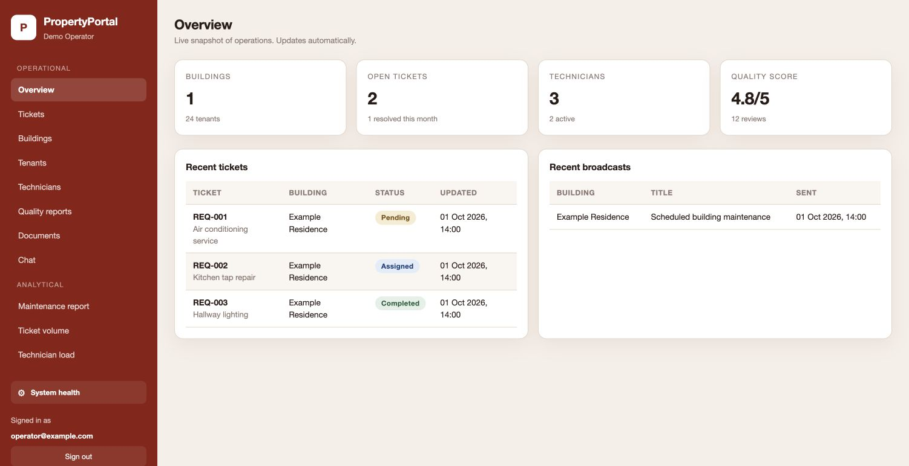
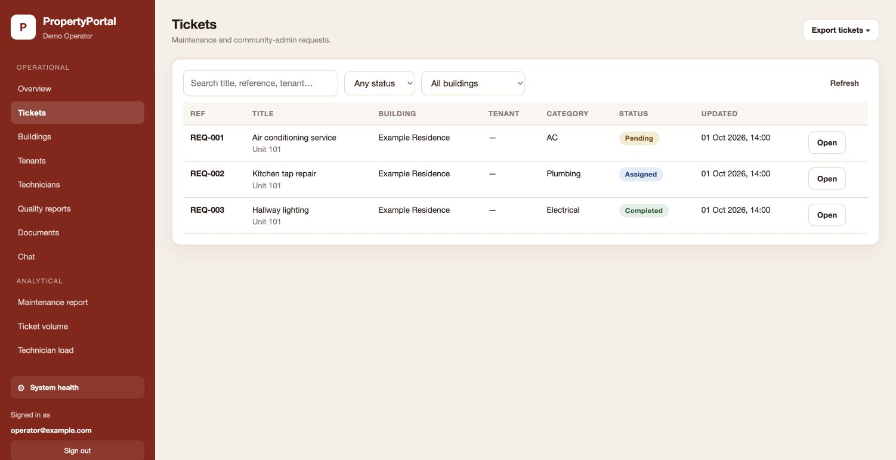

# Property Portal · Desktop

A **React and Electron** operations console for property teams. Manage maintenance requests, buildings, residents and technicians, then inspect service quality and export operational reports.

[Mobile app](https://github.com/earlyad4/property-portal-mobile) · [API server](https://github.com/earlyad4/property-portal-server) · [Desktop console](https://github.com/earlyad4/property-portal-desktop)

## Screenshots

Captured from the actual React renderer in a browser using synthetic preview records. The Electron app wraps this renderer and adds native session storage, file saving and lifecycle controls.





## Features

- Overview cards for buildings, tickets, technicians and service quality.
- Ticket search, filters, assignment, status updates and conversations.
- Building and resident records, technician management and announcements.
- Quality reports and document review.
- Maintenance, volume and technician analytics; PDF and Excel exports.
- API/dependency health, backup controls and operational alert visibility.
- Electron keychain integration, session locking and native export dialogs.

## Run locally

Install **Node.js 22.12+** and npm. Configure and start the [server](https://github.com/earlyad4/property-portal-server) first.

```sh
git clone https://github.com/earlyad4/property-portal-desktop.git
cd property-portal-desktop
npm ci
cp .env.example .env
npm run dev
```

The default API runs on `http://localhost:4317`; the renderer uses port `5173`. Set `VITE_API_BASE` and `VITE_WS_BASE` in `.env` if your API uses another host. Use the operator email/password created by `npm run bootstrap-admin` in the server checkout.

For a browser-only preview:

```sh
npm run dev:renderer
```

Visit the Vite URL. Browser sessions are temporary; OS keychain and native save dialogs require Electron.

## Try with synthetic data

Run `npm run demo` in the server repository. Set the desktop `.env` values to:

```dotenv
VITE_API_BASE=http://127.0.0.1:4318
VITE_WS_BASE=ws://127.0.0.1:4318
VITE_RELEASE_ID=1.0.0-preview
```

Start `npm run dev:renderer`. Sign in with `operator@example.com` and any non-empty sample password. Overview and Tickets show synthetic examples. This read-only helper does not implement mutations, realtime events, exports or live dependency health. Use the connected backend to exercise those features.

## Typical workflow

1. Create buildings and units.
2. Register residents from the mobile app, then review the roster.
3. Add technicians and assign incoming maintenance tickets.
4. Update ticket statuses and use ticket conversations to coordinate work.
5. Send building announcements, review documents and quality reports.
6. Inspect analytics and export reports through the backend.

## Build and package

```sh
cp .env.production.example .env.production
# Fill in your own HTTPS API origin, WSS origin and release identifier.
npm run build
npm run dist:windows
```

The release validator rejects missing or localhost production endpoints. `dist:windows` creates an x64 NSIS installer under `release/windows/`; generated installers are ignored by Git. Replace the example application identifier and configure your own signing credentials before distributing a signed release. The public source does not contain company certificates or publisher identities.

The renderer production build was verified. Native Electron launch, OS keychain behavior and Windows installer signing were not verified in this publication pass.

## Public source edition

This repository contains application source and configuration templates. It includes no production database, tenant roster, uploaded documents, backups, credentials, deployment identifiers, or previous Git history. All preview records are newly created synthetic examples. Supply your own infrastructure and accounts for a connected installation.
